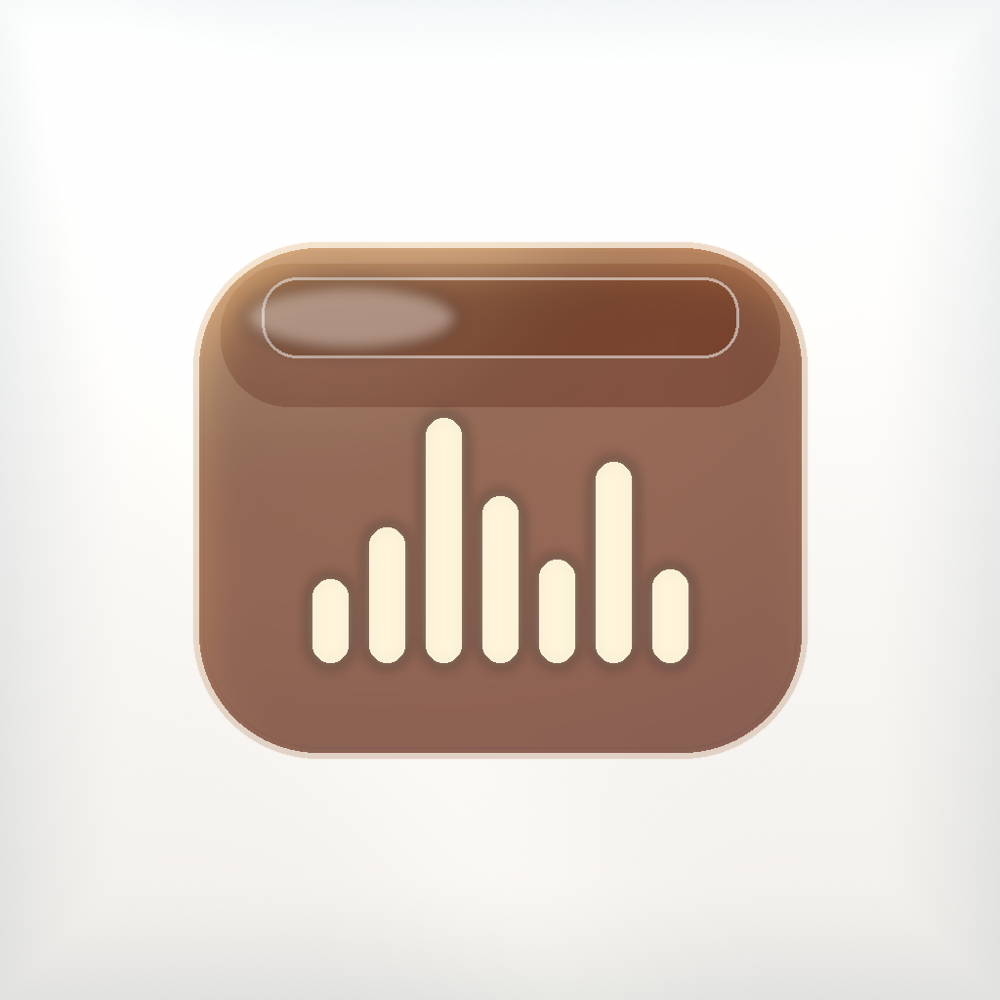

<p align="center">
  
</p>

<h1 align="center">声匣</h1>

<p align="center">
  <strong>把公开视频的整条音轨，留在自己的 iPhone 上。</strong><br>
  <em>ShengXia — a Liquid Glass player for the audio of a public video.</em>
</p>

<p align="center">
  <a href="https://github.com/giaotom/shengxia/releases/latest"></a>
  <a href="https://github.com/giaotom/shengxia/actions/workflows/build-ipa.yml"></a>
  
  
  <a href="LICENSE"></a>
</p>

<p align="center">
  <a href="https://github.com/giaotom/shengxia/releases/download/v2.0.1/ShengXia-2.0.1-unsigned.ipa"></a>
</p>

<p align="center">
  <a href="https://github.com/giaotom/shengxia/releases/tag/v2.0.1">发布页 v2.0.1</a>
  · 简体中文 · 只做 iPhone · 没有服务器，也没有账号
</p>

声匣是一个装在自己手机上的音轨匣。粘贴一条哔哩哔哩、抖音或 YouTube 的公开视频链接，它把**整条音轨**存进本机资料库，然后像一首歌一样播放。封面、进度、锁屏和后台播放都在。不上传任何东西。

---

## ✨ 打开就是提取

没有单独的首页。三个标签从左到右是 **提取**、**资料库**、**歌单**。设置是右上角一颗小齿轮。

iOS 26 用系统的 Liquid Glass：底部是悬浮的玻璃标签栏，迷你播放器贴在标签栏上方。iOS 16 到 25 用同一套布局，玻璃换成半透明磨砂，所以旧系统也不会变成一套残缺界面。

从别的 App 复制一条链接再回到声匣，顶部会问一句「要提取这条吗？」。分享菜单里如果出现「声匣」，点一下也会把链接送进来。扩展不依赖 App Group。签不上扩展时，用快捷指令打开 `shengxia://extract?text=` 加上链接，主功能照样可用。

## 🎧 正在播放

播放页是一张铺满屏幕的封面：模糊的背景、大圆角专辑图、来源胶囊，下面是一条玻璃质感的播放条。

有随机、列表循环、单曲循环、倍速（0.5×–2×）、A-B 循环、睡眠定时（按分钟，或这首播完再停）、下一首和播放队列。暂停和切歌会轻轻淡出。

没有歌词页，也没有 AirPlay。锁屏和耳机线控还在。

## 📚 资料库和歌单

资料库是真正的列表，不是几张卡片。

- 搜索标题、作者和来源
- 按哔哩哔哩、抖音、YouTube、本地筛选
- 红心收藏，也可以只看收藏
- 左滑收藏、加入下一首，或删除
- 同一条视频再提取时会认出来，可以选择仍然再存一份

歌单可以新建、改名、删除、加入、移出和拖动排序。

剪贴板、文件 App 和分享进来的音频会进同一份资料库。索引是本机的 JSON，不经过账号。

## ✂️ 留下想留的那一段

- **批量提取**：一行一条，排队下载，每一条有自己的进度，失败可以重试
- **裁剪**：拖动开头和结尾，试听，再导出成一条新音轨
- **自动处理**：可选去掉首尾静音，也可选把响度对齐到舒适的音量
- **改信息**：标题、作者、封面。封面可以从相册选；原文件里还留着画面时，也可以抓一帧
- **回到原视频**：从资料库或播放页打开来源链接
- **音质**：设置里可选较高、标准或更小。这个选择目前主要影响哔哩哔哩的音频流

新保存的音轨是 **M4A（AAC）**，哔哩哔哩给出 FLAC 时会保留 FLAC。手机没有系统的 MP3 编码器，所以声匣不会把音轨转成 MP3。你自己放进文件夹的 MP3 会原样留着。

## 📺 支持的来源

| 来源 | 可以粘贴 | 声匣会怎么做 |
| --- | --- | --- |
| 哔哩哔哩 | 视频链接、`b23.tv`、单独的 BV 号、带 `?p=` 的分 P | 读取公开的稿件信息和音频流。优先 AAC，有 FLAC 就存 FLAC。杜比音轨跳过。只剩 FLV 时会说明 iPhone 解不了 |
| 抖音 | 分享文案、`v.douyin.com` 短链、视频页 | 先试公开接口。接口不再给地址时，打开抖音自己的网页把视频地址接过来，再抽出音轨。滑块验证会以接近全屏的页面出现，滑块放大并滚到中间，可以双指再放大，通过后自动继续。图文作品没有音轨，会直接说明 |
| YouTube | `watch`、`youtu.be`、Shorts，以及 `m.` 和 Music 链接 | 只要站点返回了没有加密的 AAC 音轨就下载。私密、会员专享、年龄限制和直播会说明原因，不会绕过。手机连不上时，提示检查代理 |
| 本地 | 文件 App 里的 mp3、m4a、flac、wav，或一部带音轨的视频 | 音频直接收进资料库。视频会抽出音轨再保存 |

## 📸 界面预览

模拟器截图还没放进仓库。三张主界面会补在下面这张表里。

| 提取 | 资料库 | 正在播放 |
| :---: | :---: | :---: |
| 待补充 | 待补充 | 待补充 |

## 📲 用 Sideloadly 装到 iPhone

已签名的包不会放上来。[v2.0.1 发布页](https://github.com/giaotom/shengxia/releases/tag/v2.0.1) 里的 `ShengXia-2.0.1-unsigned.ipa` 没有签名，Sideloadly 会用你自己的 Apple ID 重新签名。同一页还有图标和 `SHA256SUMS.txt`。

免费 Apple ID 的描述文件大约 **7 天**过期，到期后再插上电脑签一次。免费账号同时能挂的自签 App 很少，个人用一台手机足够。

1. 从 [sideloadly.io](https://sideloadly.io) 安装 Sideloadly。Windows 还需要微软商店里的「Apple 设备」，或 iTunes，电脑才认得到手机。
2. 用数据线连接 iPhone，在手机上点「信任」。
3. 打开 Sideloadly，登录你的 Apple ID。开了双重认证时，去 [appleid.apple.com](https://appleid.apple.com) 生成 App 专用密码，不要填账号的主密码。
4. 把 `ShengXia-2.0.1-unsigned.ipa` 拖进去。Bundle ID 保持 `com.giaotom.shengxia` 即可。点 Start。
5. iOS 16 及以上打开开发者模式：设置 → 隐私与安全性 → 开发者模式，按提示重启。
6. 设置 → 通用 → VPN 与设备管理，信任这个 Apple ID 的证书。
7. 打开「声匣」。开始播放之后可以锁屏，不要把 App 从后台划掉，锁屏控制才会留着。

自己的文件在「文件」→ 浏览 → 我的 iPhone → 声匣 → Music。导出的资料库备份在「声匣 / 备份」。

**分享扩展的注意点。** IPA 里带了一个「声匣」分享按钮，它没有 App Group。较新的 Sideloadly 通常会一起签名。免费 Apple ID 有时签不上扩展，整包安装会因此失败。真失败的话，扩展可以不要：主 App 的提取、资料库和播放不依赖它，用快捷指令打开下面这条链接即可。

```text
shengxia://extract?text=这里放视频链接
```

## 🧩 插件，还在路上

2.0 的提取、资料库和播放是做在 App 里面的，还没有插件接口。下面是打算拆出去的方向，方便以后加来源时不用改整棵界面。代码还没开始写。

| 方向 | 想让它负责 |
| --- | --- |
| 来源插件 | 一个新的站点只实现「认链接、取公开音轨」 |
| 处理插件 | 静音修剪、响度、转码，按开关串起来 |
| 入口插件 | 剪贴板、分享扩展、快捷指令和 `shengxia://` 走同一条队列 |
| 资料库插件 | 用公开信息补标题、作者和封面 |

不会做的事情也写在这里：不绕过会员和 DRM，不做人声分离，不加歌词页。

## 🛠 技术栈

- SwiftUI，部署目标 iOS 16，只编译 iPhone
- iOS 26 的 Liquid Glass（`.glassEffect`、悬浮标签栏）；更早的系统用 `ultraThinMaterial`
- `ShengXiaCore`：链接识别、来源解析、资料库和播放队列，用 Swift Package 做单元测试
- AVFoundation 负责下载后的音轨、裁剪、响度和播放
- WebKit 只在抖音需要打开网页时用
- 资料库是 Application Support 里的 Codable JSON
- 工程用 [XcodeGen](https://github.com/yonaskolb/XcodeGen) 从 `project.yml` 生成
- 未签名 IPA 由 GitHub Actions 在 `macos-26-intel` 上构建

本地编译：

```bash
brew install xcodegen
xcodegen generate
xcodebuild \
  -project ShengXia.xcodeproj \
  -scheme ShengXia \
  -configuration Release \
  -destination 'generic/platform=iOS' \
  -sdk iphoneos \
  CODE_SIGNING_ALLOWED=NO \
  CODE_SIGNING_REQUIRED=NO \
  CODE_SIGN_IDENTITY="" \
  DEVELOPMENT_TEAM="" \
  build
```

只跑核心测试，不需要 Mac：

```bash
swift test --package-path Packages/ShengXiaCore
```

## ⚠️ 声明

声匣是个人学习项目，用来理解公开网页如何暴露音轨，以及如何在 iPhone 上做一个离线播放器。

请只提取你有权保存的公开内容，并遵守哔哩哔哩、抖音、YouTube 和当地版权法。声匣**不会**绕过大会员、会员专享、付费墙、DRM 或年龄限制，也**不会**做人声分离。需要登录或付费才能听的内容，会直接告诉你原因。

MIT 许可只覆盖这份源代码。它不授予任何视频、音频或封面的权利。

## 📄 许可

源码以 [MIT](LICENSE) 许可发布。Copyright (c) 2026 giaotom.
